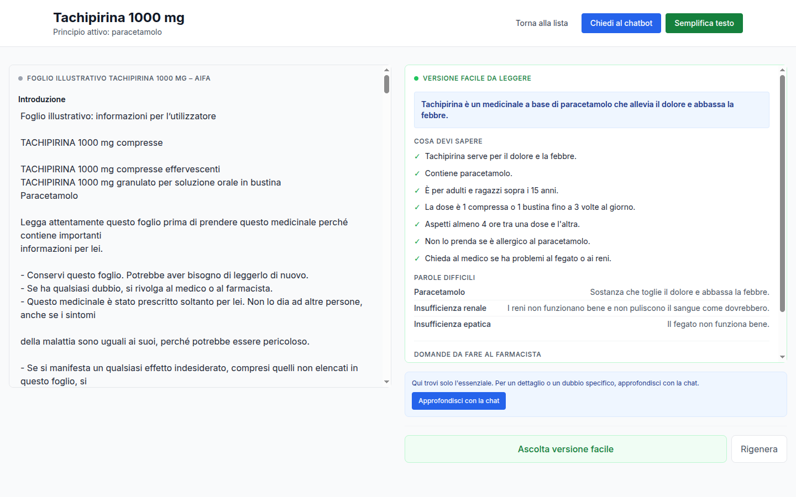

# Farmaco Chiaro

I fogli illustrativi AIFA sono completi ma difficili da leggere. **Farmaco Chiaro**
li affianca a una versione in linguaggio semplice, senza mai sostituire l'originale.

## L'idea

- **A sinistra** il foglio illustrativo originale, sempre visibile e integrale.
- **A destra** una versione facile da leggere, generata solo su richiesta.
- **Una chat** che risponde alle domande del paziente citando il punto esatto del
  foglio e lo evidenzia nell'originale.
- **La sintesi vocale** per ascoltare la versione facile.

Ogni risposta è ancorata a una fonte verificabile. L'app non fa diagnosi e non
sostituisce medico o farmacista: aiuta a capire il foglio e a parlare meglio con
un professionista.

## Demo

Prova l'app online: **https://farmaco-chiaro.vercel.app**

[](https://farmaco-chiaro.vercel.app)

## Flusso principale

1. Dalla home si cerca o si sceglie un farmaco.
2. Si apre il dettaglio: a sinistra il documento AIFA, sezionato in blocchi citabili.
3. "Semplifica" genera la versione facile, con glossario e domande da fare al farmacista.
4. La chat risponde con fonti citate; un click porta al paragrafo originale.
5. La versione facile può essere ascoltata con la sintesi vocale.

## Avvio rapido

Serve una API key OpenRouter.

```bash
# Backend
cd backend
cp .env.example .env        # inserire OPENROUTER_API_KEY
uv sync
uv run uvicorn app.main:app --host 127.0.0.1 --port 8000

# Frontend (altro terminale)
cd frontend
npm install
npm run dev
```

Aprire `http://localhost:3000`.

### Docker Compose

```bash
cp backend/.env.example backend/.env   # inserire OPENROUTER_API_KEY
docker compose up --build
```

## Comandi essenziali

```bash
make index   # rigenera l'indice dei blocchi dai markdown
make ingest  # rigenera l'indice vettoriale (richiede API key)
make test    # test backend + lint frontend
make dev     # backend e frontend in parallelo
```

Dopo aver modificato i markdown servono `make index` e `make ingest`, poi il
riavvio del backend.

## Stack

FastAPI + LangGraph per il backend, Next.js + React per il frontend, ChromaDB per
la ricerca semantica, OpenRouter per LLM, embeddings e sintesi vocale.
