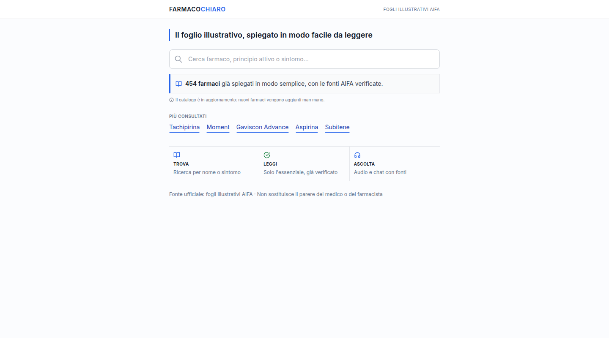
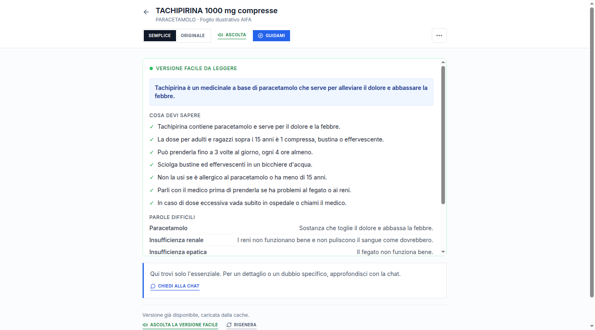

# Farmaco Chiaro

Makes Italian medicine leaflets (AIFA *fogli illustrativi*) readable: the official document stays
in view, next to a plain-language version and a chatbot that cites the exact paragraph each answer
comes from.

The app does not give diagnoses and does not replace a doctor or pharmacist. It helps people
understand a long text and prepare the questions to ask a professional.

[](https://farmaco-chiaro.vercel.app)

**[Live demo](https://farmaco-chiaro.vercel.app)** · [How it works](#how-it-works) · [Quick start](#quick-start) · [Limitations](#limitations)

> The interface is in Italian: the leaflets and their readers are Italian.

## What it does

[](https://farmaco-chiaro.vercel.app)

- **Plain / Original toggle**: the easy version is front and centre, the full original leaflet is
  one click away.
- **Plain-language version**: one-sentence summary, key points, glossary of difficult terms and
  questions to ask the pharmacist. The first generation is an explicit click; later visits load it
  from cache.
- **Citable original**: the leaflet is split into blocks. Every citation scrolls to the paragraph
  and highlights it.
- **Chat with verifiable sources**: each answer lists the blocks it used and jumps to them.
- **Guided path, "one thing at a time"**: four simple screens retrieved with semantic search and
  cited from the leaflet, with audio and a high-contrast mode.
- **"What do I do if…?"**: short, cited answers for a missed dose, a double dose, an adverse
  reaction and alcohol.
- **Shareable card** with QR code and WhatsApp link, for relatives and caregivers.
- **Text-to-speech** of the plain-language version.
- **Search by name, active ingredient or symptom** (keyword + semantic).
- **Accessibility**: loading skeletons, confirmation toasts, focus management in chat and menu,
  `prefers-reduced-motion` respected.

## How it works

```text
AIFA PDFs ─▶ Markdown ─▶ chunks + citable blocks ─▶ embeddings ─▶ Qdrant
                                                                   │
question ─▶ BM25 + vector search ─▶ Reciprocal Rank Fusion ─▶ top passages ─▶ LLM ─▶ cited answer
```

1. Leaflet PDFs are converted to Markdown and split into chunks and citable blocks
   (`backend/data/rag/`).
2. The `aifa_rag` pipeline embeds the chunks and loads them into Qdrant (Cloud or a local server),
   with a resumable on-disk cache.
3. Search combines BM25 and vector search, merges the results with Reciprocal Rank Fusion and keeps
   the most relevant passages.
4. An LLM on OpenRouter writes the answer and the plain-language version from the retrieved passages
   only.
5. If Qdrant or the embeddings are unavailable, retrieval falls back to BM25 and the app keeps working.

| Component | Technology | Role |
|---|---|---|
| Frontend | Next.js 16, React 19, Tailwind CSS | UI and same-origin proxy to the backend |
| Backend | FastAPI, LangGraph | REST API and chat orchestration |
| Retrieval | Qdrant, BM25, RRF | Semantic search for guide/chat/scenarios; keyword + semantic on the home page |
| LLM and AI services | OpenRouter | Chat, simplification, embeddings, text-to-speech |
| Data | AIFA JSON | Registry, chunks and citable blocks for 621 leaflets |

```text
.
├── backend/
│   ├── app/            # FastAPI: routes, schemas, configuration
│   ├── aifa_rag/       # dataset, embedding and Qdrant index pipeline
│   ├── graph/          # LangGraph chat graph
│   ├── services/       # retrieval, simplification, citations, TTS
│   ├── eval/           # retrieval evaluation questions
│   └── data/rag/       # chunks, sections, blocks and registry (runtime snapshot)
├── frontend/           # Next.js App Router
├── docs/               # demo screenshots, design notes
├── docker-compose.yml  # frontend + backend + local Qdrant
└── vercel.json         # Vercel Services deploy, redirects and cron
```

## Key decisions

- **Every answer is grounded in citable blocks.** Answers are generated from the retrieved passages,
  and the UI links each one back to the paragraph in the original leaflet, so a reader can always
  check the source.
- **Hybrid retrieval with a safe fallback.** BM25 catches exact drug names and doses; vectors catch
  paraphrases and symptoms. If the vector store is down, BM25 alone keeps the app usable.
- **The runtime data is a committed snapshot.** `backend/data/rag/` holds the generated chunks,
  sections and registry that the backend container ships with, so a deploy needs no ingestion step.
  `make dataset` and `make index` regenerate it from the Markdown files.
- **Retrieval is evaluated, not assumed.** `make eval` scores dense retrieval on
  `backend/eval/qa.jsonl`, and `backend/tests/data/golden_set.json` guards the retrieval tests.

## Quick start

Requirements: Python 3.13 with [uv](https://docs.astral.sh/uv/), Node.js 20+ and an
[OpenRouter](https://openrouter.ai/) API key.

```bash
# Backend
cd backend
cp .env.example .env        # set OPENROUTER_API_KEY
uv sync
uv run uvicorn app.main:app --host 127.0.0.1 --port 8000

# Frontend (in another terminal)
cd frontend
npm install
npm run dev
```

Open `http://localhost:3000`. The frontend forwards `/api/*` to the backend, so the browser stays on
one origin.

### Docker Compose

```bash
cp backend/.env.example backend/.env   # set OPENROUTER_API_KEY
docker compose up -d qdrant
# Index into the local Qdrant (once, or after regenerating the dataset)
cd backend && QDRANT_URL=http://localhost:6333 uv run python -m aifa_rag.cli index
cd .. && docker compose up --build
```

### Commands

| Command | Description |
|---|---|
| `make dev` | Run backend and frontend together |
| `make dataset` | Regenerate chunks, sections, blocks and registry from the Markdown files |
| `make index` | Compute embeddings and load the index into Qdrant |
| `make eval` | Evaluate dense retrieval on `backend/eval/qa.jsonl` |
| `make test` | Backend tests and frontend lint |
| `make lint` | Ruff on the backend, ESLint on the frontend |
| `make build` | Production build of the frontend |
| `make up` / `make down` | Start or stop Docker Compose |

After regenerating the dataset, run `make index` and restart the backend. `make index` reads
`QDRANT_URL` and `QDRANT_API_KEY` from `backend/.env`.

## Tests

```bash
make test
```

Backend tests run with `pytest` (retrieval, citations, chat graph, API, scenarios, text-to-speech);
the frontend is checked with ESLint and a production build. CI runs both on every push.

## Deploy

Production runs on **Vercel Services** with two services:

- `frontend`: the Next.js app.
- `backend`: the FastAPI container, reached from the frontend through the private `BACKEND_URL` binding.

The configuration is in `vercel.json`. The backend container ships the runtime artifacts in
`backend/data/rag/`; the vectors live on Qdrant Cloud. Set `QDRANT_URL` and `QDRANT_API_KEY` for
Production and Preview, then load the index once from your machine:

```bash
cd backend
uv run python -m aifa_rag.cli index
```

A daily cron on `/api/rag/keepalive` stops the Qdrant free tier from being suspended. Status is
visible at `/api/rag/status`. If Qdrant is unreachable, retrieval keeps working with BM25.

## Limitations

- The simplified text is LLM-generated from the leaflet. It can omit or soften details, which is why
  the original stays one click away and every statement is cited.
- Coverage is the 621 leaflets currently in the dataset; the catalogue is still growing.
- Retrieval quality is measured on a small question set (30 questions in `backend/eval/qa.jsonl`), not a large benchmark.
- The interface and the content are Italian only.
